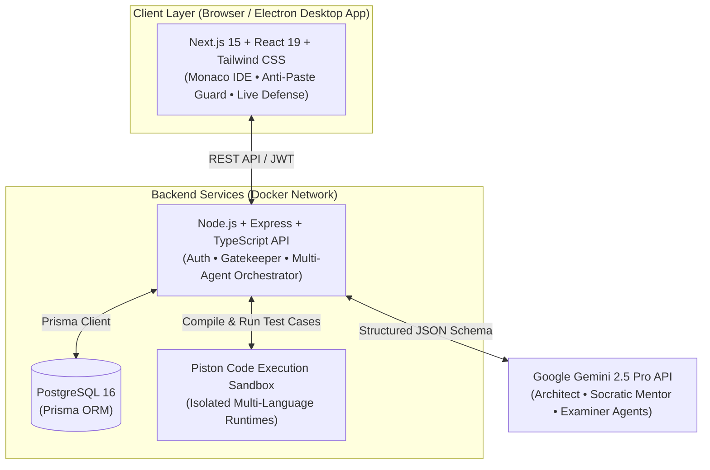

# CodeMentor AI Studio

**CodeMentor AI Studio** là nền tảng huấn luyện kỹ sư phần mềm thực chiến trên trình duyệt và Desktop App, được thiết kế để triệt tiêu tình trạng lệ thuộc vào AI viết code hộ. Hệ thống đóng vai trò một **Giảng viên & Hội đồng thẩm định kỹ thuật khắt khe**, rèn luyện tư duy phân tích logic từ gốc rễ, tiêu chuẩn Clean Code, thiết kế kiến trúc hệ thống và kiểm tra năng lực qua phiên **Bảo vệ Đồ án Trực tiếp (Live Defense)**.

---

## 1. Tính năng Cốt lõi

* **Lộ trình Công nghệ Đa tầng & Tái sử dụng:** Học viên có thể đăng ký học nhiều ngôn ngữ (*TypeScript, Python, Java, C#, Go, C++...*) và framework (*Next.js, NestJS, Spring Boot, ASP.NET Core, FastAPI...*). Hệ thống tự động điều chỉnh độ sâu giáo trình dựa trên các ngôn ngữ học viên đã tốt nghiệp trước đó.
* **Giảng viên Socratic AI:** Bị khóa cứng quy tắc **tuyệt đối không viết code giải hộ**. AI chỉ phân tích bản chất cơ chế vận hành, chia nhỏ luồng dữ liệu (Input → Process → Edge Cases → Output) và đặt câu hỏi gợi mở.
* **Cơ chế Khóa chương Nghiêm ngặt (Gatekeeper):** Kết thúc mỗi chương, học viên phải vượt qua bài kiểm tra gồm câu hỏi phân tích bản chất và bài lập trình chạy trên Sandbox (đạt tối thiểu **7.0/10 điểm** và **3/4 test cases**) mới được mở khóa chương tiếp theo. Nếu trượt, bắt buộc ôn tập và thi lại đề mới.
* **Chốt chặn Thiết kế Kiến trúc (Blueprint Gate):** Trước khi lập trình đồ án cuối khóa (từ danh sách gợi ý hoặc ý tưởng tự đề xuất), học viên bắt buộc nộp **Cây thư mục dự án** và **Luồng xử lý dữ liệu**. Tech Lead AI chỉ mở khóa IDE khi cấu trúc đạt chuẩn tách bạch trách nhiệm.
* **IDE Đa file & Anti-Paste Guard:** Tích hợp **Monaco Editor** (lõi VS Code) hỗ trợ quản lý nhiều tệp, chạy thử code trực tiếp trên Sandbox, đồng thời chặn và ghi nhận vi phạm nếu học viên dán đoạn code lớn từ nguồn bên ngoài.
* **Phòng Bảo vệ Đồ án Trực tiếp (Live Defense):** Đồng hồ đếm ngược **45 phút** kèm **3 yêu cầu sửa code trực tiếp** được Hội đồng AI tạo riêng dựa trên chính điểm yếu trong mã nguồn học viên vừa nộp.
  * Đạt **0/3** yêu cầu: Đánh trượt, yêu cầu xây dựng lại đồ án.
  * Đạt từ **1/3** yêu cầu trở lên và tổng điểm từ **5.0/10** (4.0 Logic + 3.0 Clean Code + 3.0 Live Defense): Tốt nghiệp và nhận **Bằng khen điện tử kèm mã QR xác thực công khai**.

---

## 2. Kiến trúc Hệ thống



---

## 3. Cấu trúc Thư mục Monorepo

```text
code-mentor-platform/
├── apps/
│   ├── web/                                  # Frontend Next.js 15 (App Router)
│   │   ├── src/
│   │   │   ├── app/
│   │   │   │   ├── dashboard/                # Đăng nhập, quản lý lộ trình, chọn đề tài đồ án
│   │   │   │   ├── workspace/[trackId]/      # Không gian học tập 3 cột + Blueprint Gate
│   │   │   │   ├── defense/[trackId]/        # Phòng bảo vệ đồ án đếm ngược 45 phút
│   │   │   │   └── certificates/[code]/      # Trang bằng khen & tra cứu mã QR
│   │   │   ├── components/                   # Monaco IDE, Diff Editor, Socratic Chat, Modals
│   │   │   ├── lib/                          # HTTP API Client
│   │   │   ├── store/                        # Zustand State Management
│   │   │   └── types/                        # TypeScript Interfaces
│   │   ├── Dockerfile
│   │   └── next.config.ts
│   │
│   ├── api/                                  # Backend Node.js + Express + TypeScript
│   │   ├── src/
│   │   │   ├── agents/                       # Multi-Agent AI Service (Gemini 2.5 Pro)
│   │   │   ├── config/                       # Prisma Client Singleton
│   │   │   ├── middlewares/                  # JWT Auth & Global Error Handler
│   │   │   ├── modules/                      # Auth, Tracks, Assessments, Capstone
│   │   │   ├── sandbox/                      # Piston Sandbox Execution & Test Runner
│   │   │   ├── app.ts
│   │   │   └── server.ts
│   │   └── Dockerfile
│   │
│   └── desktop/                              # Ứng dụng Desktop (Electron + Electron Builder)
│       ├── src/
│       │   ├── main.ts                       # Khởi chạy Next.js Standalone & quản lý cửa sổ
│       │   └── preload.ts
│       └── electron-builder.yml              # Cấu hình đóng gói Windows / macOS / Linux
│
├── packages/
│   └── database/
│       └── prisma/
│           └── schema.prisma                 # Thiết kế cơ sở dữ liệu toàn hệ thống
│
├── scripts/
│   └── install-piston-runtimes.sh            # Script cài đặt trình biên dịch đa ngôn ngữ
├── docker-compose.yml                        # Khởi chạy toàn bộ stack (DB, Piston, API, Web)
├── .dockerignore
└── .env.example
```

---

## 4. Cấu hình Biến Môi trường

Tạo tệp `.env` tại thư mục gốc từ mẫu `.env.example` và điền đầy đủ thông tin:

| Biến môi trường | Giá trị mặc định / Mẫu | Mô tả |
| :--- | :--- | :--- |
| `POSTGRES_USER` | `postgres` | Tên người dùng cơ sở dữ liệu PostgreSQL |
| `POSTGRES_PASSWORD` | `codementor_secret_password` | Mật khẩu kết nối PostgreSQL |
| `POSTGRES_DB` | `codementor` | Tên cơ sở dữ liệu |
| `POSTGRES_PORT` | `5432` | Cổng PostgreSQL |
| `PISTON_PORT` | `2000` | Cổng dịch vụ Piston Code Sandbox |
| `PISTON_API_URL` | `http://piston:2000/api/v2` | URL nội bộ (Docker) hoặc `http://localhost:2000/api/v2` (Local) |
| `API_PORT` | `4000` | Cổng Backend Express API |
| `JWT_SECRET` | `your-secret-jwt-key` | Chuỗi bí mật ký token xác thực người dùng |
| `GEMINI_API_KEY` | `AIzaSy...` | API Key của Google Gemini (bắt buộc) |
| `WEB_PORT` | `3000` | Cổng giao diện Frontend Next.js |
| `NEXT_PUBLIC_API_URL` | `http://localhost:4000/api` | Endpoint API mà trình duyệt gọi tới |

---

## 5. Hướng dẫn Triển khai bằng Docker (Khuyên dùng)

Triển khai toàn bộ 4 dịch vụ (**PostgreSQL**, **Piston Code Sandbox**, **Backend API**, **Frontend Web**) chỉ bằng một câu lệnh:

### Bước 1: Khởi tạo tệp cấu hình & Build Containers
```bash
cp .env.example .env
# Mở tệp .env và điền GEMINI_API_KEY cùng JWT_SECRET của bạn

docker compose up -d --build
```
*(Backend API sẽ tự động chạy `prisma migrate deploy` để khởi tạo bảng dữ liệu trước khi nhận kết nối).*

### Bước 2: Cài đặt các trình biên dịch ngôn ngữ vào Piston Sandbox
Chạy script sau **1 lần duy nhất** để tải các gói ngôn ngữ (**JavaScript, TypeScript, Python, Java, C#, C++, Go**) vào Docker Volume `piston_packages`:

* **Trên Linux / macOS / Git Bash:**
  ```bash
  chmod +x scripts/install-piston-runtimes.sh
  ./scripts/install-piston-runtimes.sh
  ```

* **Trên Windows (PowerShell):**
  ```powershell
  $packages = @(
    '{"language":"node","version":"18.15.0"}',
    '{"language":"typescript","version":"5.0.3"}',
    '{"language":"python","version":"3.10.0"}',
    '{"language":"java","version":"15.0.2"}',
    '{"language":"mono","version":"6.12.0"}',
    '{"language":"gcc","version":"10.2.0"}',
    '{"language":"go","version":"1.16.2"}'
  )
  foreach ($pkg in $packages) {
    Invoke-RestMethod -Uri "http://localhost:2000/api/v2/packages" -Method Post -ContentType "application/json" -Body $pkg
  }
  ```

### Bước 3: Truy cập Hệ thống
* **Giao diện Học tập (Dashboard):** `http://localhost:3000/dashboard`
* **Kiểm tra trạng thái API:** `http://localhost:4000/health`

---

## 6. Hướng dẫn Chạy Môi trường Phát triển (Local Development)

### Yêu cầu tiên quyết
* **Node.js** phiên bản `>= 20.x`
* **PostgreSQL** `16` đang chạy trên máy
* **Piston Sandbox** (có thể chạy riêng container Piston bằng lệnh: `docker run -d --privileged -p 2000:2000 ghcr.io/engineer-man/piston:latest`)

### Các bước khởi chạy
1. **Khởi tạo Cơ sở dữ liệu (Prisma):**
   ```bash
   cd apps/api
   cp .env.example .env
   npm install
   npx prisma migrate dev --name init --schema=../../packages/database/prisma/schema.prisma
   ```

2. **Chạy Backend API (`http://localhost:4000`):**
   ```bash
   cd apps/api
   npm run dev
   ```

3. **Chạy Frontend Web (`http://localhost:3000`):**
   ```bash
   cd apps/web
   cp .env.example .env
   npm install
   npm run dev
   ```

---

## 7. Hướng dẫn Đóng gói Desktop App (Electron)

Ứng dụng Desktop đóng gói sẵn bản dựng `standalone` của Next.js bên trong Electron, hoạt động độc lập như một phần mềm IDE trên máy tính cá nhân.

1. **Cài đặt dependencies cho module Desktop:**
   ```bash
   cd apps/desktop
   npm install
   ```

2. **Chạy thử chế độ Desktop Development:**
   ```bash
   npm run dev
   ```

3. **Xuất bộ cài đặt Production (tệp thành phẩm nằm trong thư mục `apps/desktop/release/`):**
   * **Windows (`.exe` NSIS Installer):**
     ```bash
     npm run dist:win
     ```
   * **macOS (`.dmg`):**
     ```bash
     npm run dist:mac
     ```
   * **Linux (`.AppImage`):**
     ```bash
     npm run dist:linux
     ```

---

## 8. Tóm tắt API Endpoints Chính

| Nhóm chức năng | Method | Endpoint | Mô tả |
| :--- | :--- | :--- | :--- |
| **Xác thực** | `POST` | `/api/auth/register` | Đăng ký tài khoản học viên mới |
| | `POST` | `/api/auth/login` | Đăng nhập và nhận JWT Token |
| | `GET` | `/api/auth/me` | Lấy thông tin học viên hiện tại |
| **Lộ trình & Mentor** | `POST` | `/api/tracks` | Đăng ký lộ trình ngôn ngữ/framework mới (AI sinh giáo trình) |
| | `GET` | `/api/tracks` | Lấy danh sách lộ trình, tiến độ chương và chứng chỉ |
| | `POST` | `/api/tracks/mentor/ask` | Trao đổi với Giảng viên Socratic AI |
| **Sandbox & Thi chương** | `POST` | `/api/assessments/sandbox/run` | Biên dịch và chạy thử code đa ngôn ngữ |
| | `POST` | `/api/assessments/modules/:moduleId/exam/start` | Sinh đề kiểm tra kết thúc chương |
| | `POST` | `/api/assessments/exam/submit` | Nộp bài thi, chạy test cases và chấm điểm qua môn |
| **Đồ án & Bảo vệ** | `POST` | `/api/capstone/tracks/:trackId/options` | Lấy 3 đồ án gợi ý hoặc chuẩn hóa đề tài tự đề xuất |
| | `POST` | `/api/capstone/tracks/:trackId/topic` | Chốt đề tài đồ án cuối khóa |
| | `POST` | `/api/capstone/tracks/:trackId/blueprint` | Nộp thiết kế kiến trúc qua cổng Blueprint Gate |
| | `POST` | `/api/capstone/tracks/:trackId/defense/start` | Nộp code đồ án & mở phiên Live Defense 45 phút |
| | `GET` | `/api/capstone/tracks/:trackId/defense/active` | Khôi phục phiên bảo vệ đang diễn ra |
| | `POST` | `/api/capstone/defense/challenge/save` | Lưu bài sửa của từng thử thách trong 3 yêu cầu |
| | `POST` | `/api/capstone/defense/sessions/:sessionId/finalize` | Chốt phiên bảo vệ, chấm thang 10 và cấp bằng khen |
| **Bằng khen** | `GET` | `/api/certificates/verify/:code` | Tra cứu và xác thực bằng khen công khai qua mã QR |